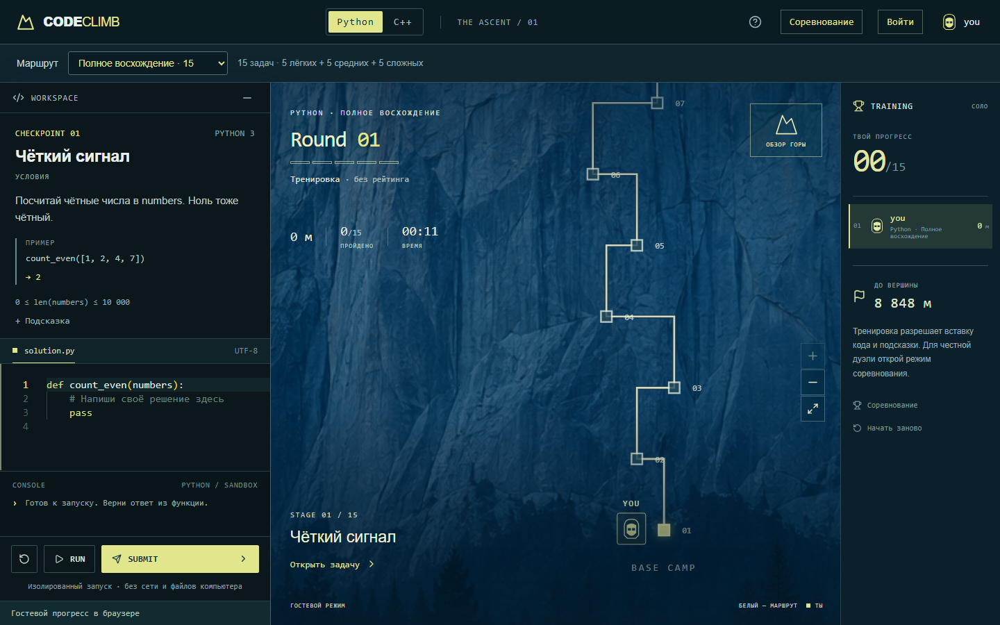
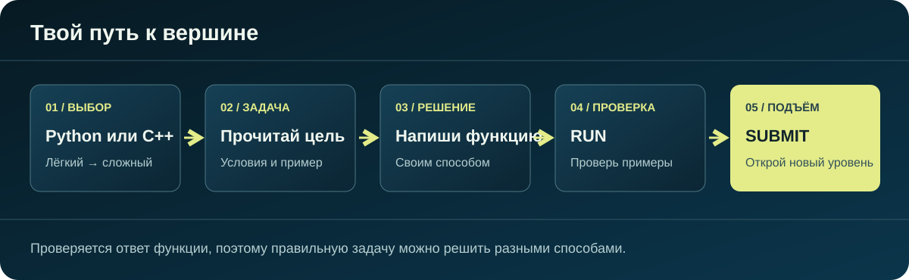

  
  <h1>CODE CLIMB</h1>
  
Решай задачи на Python и C++, проходи уровни и поднимайся к вершине.

  
Python · C++ · 15 уровней · тренировка и соревнование

## Игра

CODE CLIMB превращает практику программирования в восхождение. На каждом уровне тебя ждёт задача: прочитай условие, напиши функцию и проверь её. Решение можно придумать по-своему — игра оценивает результат работы кода, а не совпадение с заранее записанным ответом.

## Выбери свой маршрут

- **Два языка:** Python и C++. Для каждого — собственный набор задач.
- **Три сложности:** лёгкие, средние и сложные задачи можно проходить отдельно.
- **Полное восхождение:** маршрут из 15 уровней — от первых шагов до серьёзных алгоритмических испытаний.
- **Классика:** исходный маршрут из 15 задач тоже доступен.

В редакторе можно запустить код на примерах кнопкой **RUN**. Когда решение готово, **SUBMIT** проверит его на дополнительных тестах и откроет следующий уровень. Необязательно писать код единственным «правильным» способом.

## Соревнование

Два игрока получают одинаковые пять задач и одновременно начинают раунд. Побеждает тот, кто решит больше задач за отведённое время; при равном результате важна скорость. Здесь нет ботов и вставки готового кода — каждый пишет решение сам. Ответы проверяются на скрытых тестах.

## Прогресс и подсказки

Можно тренироваться без аккаунта, сохраняя прогресс на своём устройстве, или зарегистрироваться, чтобы сохранять его в профиле. Для регистрации предусмотрено подтверждение почты, а в профиле можно сменить пароль.

Если задача застопорила, короткая наводка доступна бесплатно. Более подробная подсказка может открываться за добровольный просмотр рекламы, когда эта возможность включена; за раунд доступно не больше трёх таких подсказок. Проходить игру можно и без рекламы.

---

<strong>Один уровень. Одно решение. Ещё шаг к вершине.</strong>

